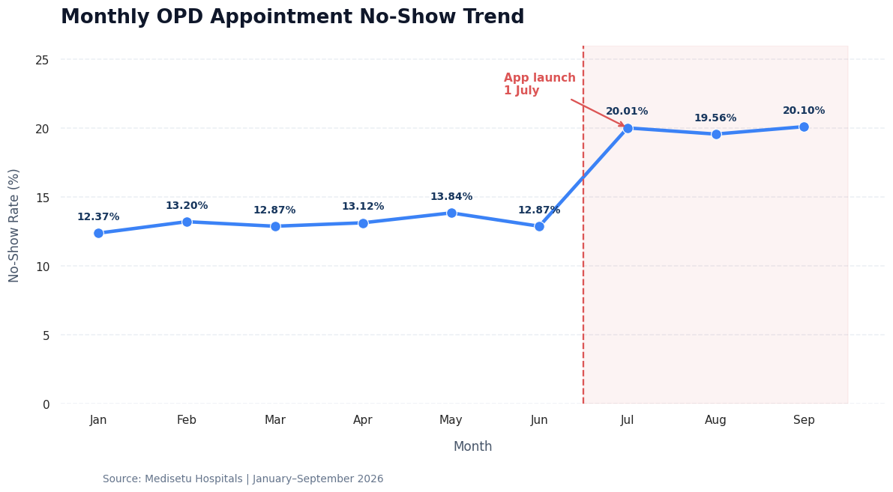
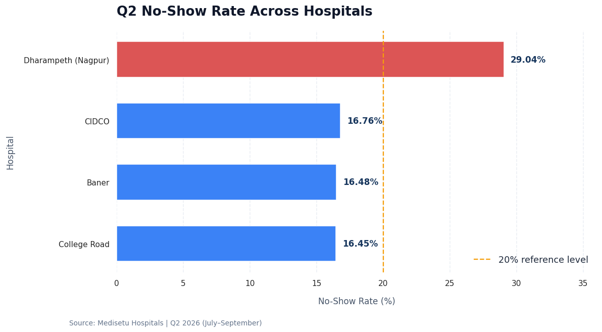
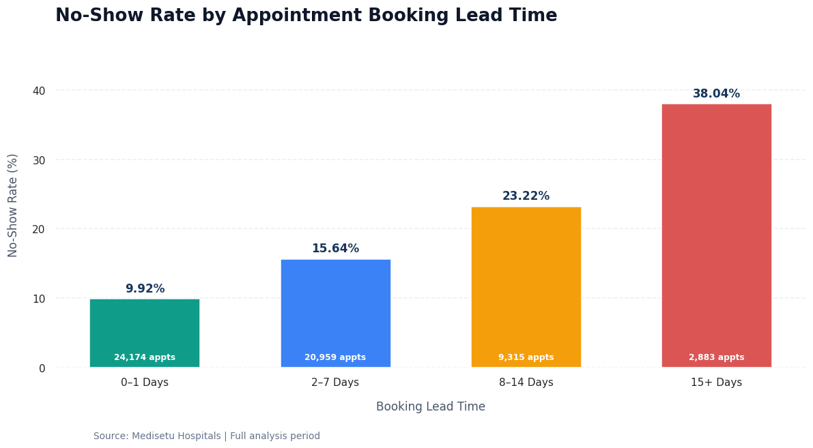
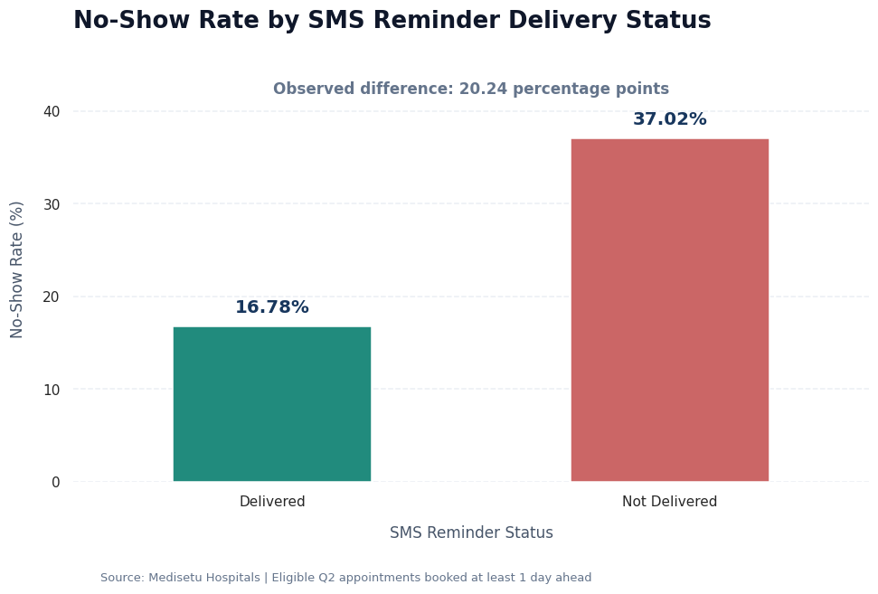

# OPD Appointment No-Show Spike

**Healthcare** · SQL, Python (pandas, seaborn)

Patients are missing far more outpatient appointments since July. Find out where and why — SMS reminders, the new booking app, departments or patients — and how much revenue it is costing.

> A live industry project on [JobPrax](https://www.jobprax.com). The client, Medisetu Hospitals Pvt Ltd, and its data are simulated.
> Certificate: [https://www.jobprax.com/certificates/DD-WDCZ-C6ER](https://www.jobprax.com/certificates/DD-WDCZ-C6ER)

## Business problem

Management does not know how much the no-show rate has risen, which hospitals, departments and booking channels are affected, or why. Possible causes raised in the leadership meeting include the new patient app, problems with SMS reminders, and particular departments or patient groups. The Chief Operating Officer needs a clear, data-backed analysis of appointments from 2 January to 30 September 2026 to decide what to fix first.

## Objectives

- Clean the appointment data and calculate the no-show rate for Q1 (April–June) and Q2 (July–September) 2026.
- Find which hospitals, departments, booking channels, payment modes and patient groups have the highest no-show rates.
- Check whether SMS reminders reached patients and how much they reduce no-shows.
- Measure the effect of booking lead time and of the new patient app.
- Estimate the consultation revenue lost to no-shows and recommend practical actions.

## Executive summary

The outpatient appointment no-show rate increased from 13.27% in Q1 to 19.89% in Q2, a rise of 6.62 percentage points. The issue is most severe at the Dharampeth hospital in Nagpur, where the Q2 no-show rate reached 29.04%, compared with 13.21% in Q1. Q2 no-shows resulted in an estimated ₹31.09 lakh in lost consultation revenue. Key patterns include low SMS reminder delivery at Dharampeth (18.83%), a higher no-show rate for app bookings (26.28%), and increasing no-shows with longer booking lead times. The immediate priority should be to restore reminder delivery at Dharampeth, investigate the app booking journey, and introduce targeted follow-ups for appointments booked well in advance.

## Key findings

1. Overall no-show trend (Chart 1): The no-show rate increased from 13.27% in Q1 to 19.89% in Q2, a 6.62 percentage-point increase. As Chart 1 shows, monthly rates rose sharply from 12.87% in June to 20.01% in July and remained around 20% through September.

2. Hospital performance (Chart 2): Dharampeth recorded the highest Q2 no-show rate at 29.04%, up from 13.21% in Q1 (+15.83 percentage points). The other hospitals recorded rates between 16.45% and 16.76%.

3. SMS reminder effectiveness (Chart 4): Eligible Q2 appointments with delivered reminders had a 16.78% no-show rate, compared with 37.02% for appointments without delivered reminders. At Dharampeth, reminder delivery fell from approximately 96% during January–June to 18.83% in Q2. This indicates a strong association, not proven causation.

4. Booking lead time (Chart 3): No-show rates increased with booking lead time, from 9.92% for appointments booked 0–1 days ahead to 38.04% for appointments booked 15 or more days ahead. Q2 app bookings recorded a 26.28% no-show rate and an average booking lead time of 11.8 days, the highest among booking channels.

5. Financial and department impact: Q2 no-shows represented an estimated ₹31.09 lakh in lost consultation revenue. Psychiatry recorded the highest overall departmental no-show rate at 23.87%. Additionally, 504 patients had three or more no-show appointments.

Overall, the findings identify Dharampeth's reminder delivery, app booking performance, and long booking lead times as priority areas for investigation. The app launch coincided with the increase, but the available analysis does not establish that it caused the increase.

## Recommendations

1. Restore SMS delivery at Dharampeth immediately: Investigate the delivery failure responsible for the Q2 reminder delivery rate falling to 18.83%. Audit SMS gateway logs, contact details, and delivery configuration. Set a proposed delivery target of at least 95%, in line with the delivery levels observed at the other hospitals.

2. Improve the app booking journey: Investigate why app bookings have a 26.28% no-show rate and an average lead time of 11.8 days. Review confirmation messages, appointment visibility, cancellation options, and rescheduling experience. Monitor app no-show rates weekly against other booking channels.

3. Introduce lead-time-based reminders: Prioritise appointments booked 8 or more days in advance, as their no-show rates are 23.22% for 8–14 days and 38.04% for 15+ days. Use confirmation and reminder follow-ups closer to the appointment date.

4. Target repeat no-show patients and high-risk departments: Identify and follow up with the 504 patients who had at least three no-shows. Give Psychiatry special attention because it recorded the highest overall departmental no-show rate at 23.87%.

5. Track financial impact and operational performance: Review hospital-wise no-show rates, reminder delivery, and lost consultation revenue every month. Prioritise reducing the Q2 loss of approximately ₹31.09 lakh through measurable improvements in attendance and reminder delivery.

## Charts









## What I did

- Solved 50 of 50 analysis tasks tied to the business requirements
- Wrote 30 SQL queries, one per task, in [`sql/`](sql)
- Explored and charted the data in Python, in [`notebook/analysis.ipynb`](notebook/analysis.ipynb)
- Wrote a final report with findings and recommendations, in [`report/report.md`](report/report.md)

## Skills

Data cleaning · Joins and aggregation · Rates and percentages · Trend analysis · Executive reporting

## Data

- **Appointments** (`appointments.csv`): One row per OPD appointment, as extracted from the booking system. Contains duplicates and inconsistent formats.
- **SMS reminders** (`sms_reminders.csv`): Reminder messages sent the day before each appointment booked at least a day ahead. A failed SMS may be retried once.
- **Doctors** (`doctors.csv`): Doctors taking OPD consultations (no names).
- **Patients** (`patients.csv`): Registered patients (no names or contact details).
- **Hospitals** (`hospitals.csv`): The four Medisetu hospitals.

Column details and a sample of each table are in [`data/`](data).

## Repository structure

```
sql/          one SQL file per task
notebook/     Python analysis
report/       final report and charts
data/         table samples and column descriptions
```
