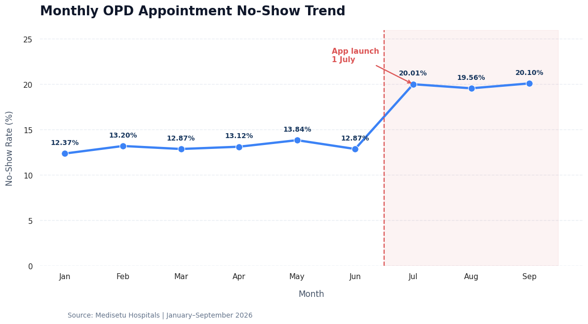
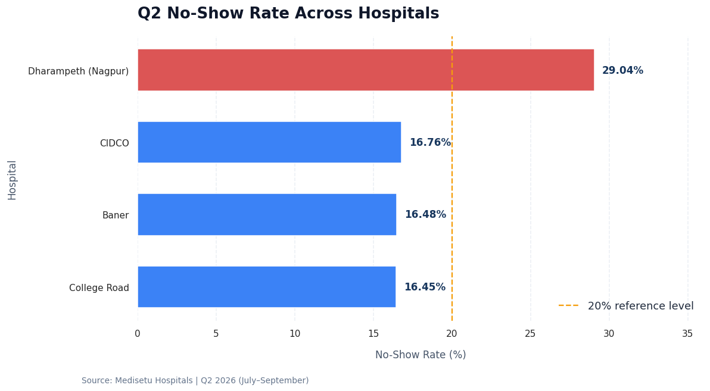
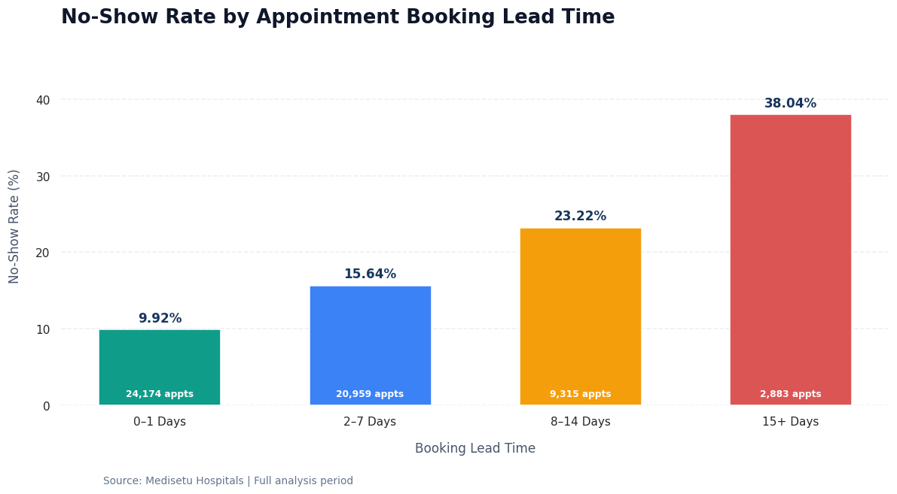
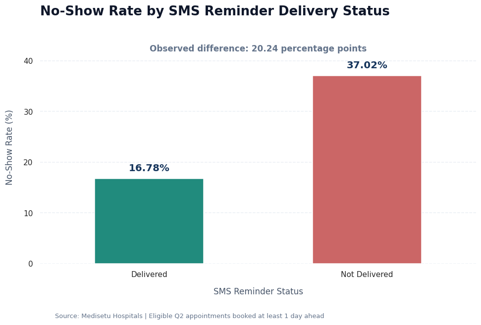

# OPD Appointment No-Show Spike: final report

## Executive summary

The outpatient appointment no-show rate increased from 13.27% in Q1 to 19.89% in Q2, a rise of 6.62 percentage points. The issue is most severe at the Dharampeth hospital in Nagpur, where the Q2 no-show rate reached 29.04%, compared with 13.21% in Q1. Q2 no-shows resulted in an estimated ₹31.09 lakh in lost consultation revenue. Key patterns include low SMS reminder delivery at Dharampeth (18.83%), a higher no-show rate for app bookings (26.28%), and increasing no-shows with longer booking lead times. The immediate priority should be to restore reminder delivery at Dharampeth, investigate the app booking journey, and introduce targeted follow-ups for appointments booked well in advance.

## Data quality

The appointments extract contained 57,495 rows. Analysis identified 140 exact duplicate rows, which were removed, leaving 57,355 distinct appointment records. The raw status field contained nine different formats, including variations such as 'Completed', 'COMPLETED', 'No-show', and 'No Show'. These were standardised into three categories: completed, noshow, and cancelled.

A total of 4,029 appointment fee values contained text or currency formatting such as ₹ or Rs. These values were cleaned by retaining numeric fee characters for revenue calculations. Gender contained six raw formats (M, Male, male, F, Female, female), standardised into Male and Female. The old city name 'Aurangabad' was treated as equivalent to 'Chhatrapati Sambhajinagar' for city-level analysis; the combined patient count was 3,800.

Additionally, 258 patients had no recorded age. This missingness was identified and should be considered when interpreting age-based results. The SMS reminders table contained 48,393 records, including 40,242 delivered and 8,151 failed messages. Since an appointment could have reminder retries, reminder records were evaluated at appointment level to avoid inflating appointment counts.

## Findings

1. Overall no-show trend (Chart 1): The no-show rate increased from 13.27% in Q1 to 19.89% in Q2, a 6.62 percentage-point increase. As Chart 1 shows, monthly rates rose sharply from 12.87% in June to 20.01% in July and remained around 20% through September.

2. Hospital performance (Chart 2): Dharampeth recorded the highest Q2 no-show rate at 29.04%, up from 13.21% in Q1 (+15.83 percentage points). The other hospitals recorded rates between 16.45% and 16.76%.

3. SMS reminder effectiveness (Chart 4): Eligible Q2 appointments with delivered reminders had a 16.78% no-show rate, compared with 37.02% for appointments without delivered reminders. At Dharampeth, reminder delivery fell from approximately 96% during January–June to 18.83% in Q2. This indicates a strong association, not proven causation.

4. Booking lead time (Chart 3): No-show rates increased with booking lead time, from 9.92% for appointments booked 0–1 days ahead to 38.04% for appointments booked 15 or more days ahead. Q2 app bookings recorded a 26.28% no-show rate and an average booking lead time of 11.8 days, the highest among booking channels.

5. Financial and department impact: Q2 no-shows represented an estimated ₹31.09 lakh in lost consultation revenue. Psychiatry recorded the highest overall departmental no-show rate at 23.87%. Additionally, 504 patients had three or more no-show appointments.

Overall, the findings identify Dharampeth's reminder delivery, app booking performance, and long booking lead times as priority areas for investigation. The app launch coincided with the increase, but the available analysis does not establish that it caused the increase.

## Recommendations

1. Restore SMS delivery at Dharampeth immediately: Investigate the delivery failure responsible for the Q2 reminder delivery rate falling to 18.83%. Audit SMS gateway logs, contact details, and delivery configuration. Set a proposed delivery target of at least 95%, in line with the delivery levels observed at the other hospitals.

2. Improve the app booking journey: Investigate why app bookings have a 26.28% no-show rate and an average lead time of 11.8 days. Review confirmation messages, appointment visibility, cancellation options, and rescheduling experience. Monitor app no-show rates weekly against other booking channels.

3. Introduce lead-time-based reminders: Prioritise appointments booked 8 or more days in advance, as their no-show rates are 23.22% for 8–14 days and 38.04% for 15+ days. Use confirmation and reminder follow-ups closer to the appointment date.

4. Target repeat no-show patients and high-risk departments: Identify and follow up with the 504 patients who had at least three no-shows. Give Psychiatry special attention because it recorded the highest overall departmental no-show rate at 23.87%.

5. Track financial impact and operational performance: Review hospital-wise no-show rates, reminder delivery, and lost consultation revenue every month. Prioritise reducing the Q2 loss of approximately ₹31.09 lakh through measurable improvements in attendance and reminder delivery.

## Charts

